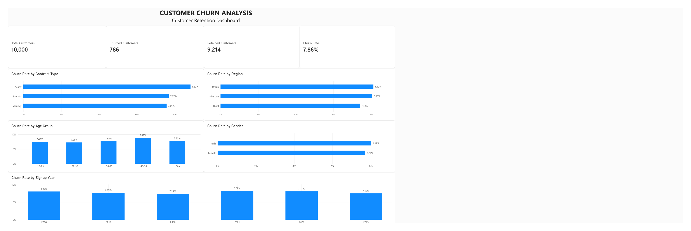

# Customer Churn & Retention Analysis

An end-to-end data analytics project using **Python, Pandas, MySQL, and
Power BI** to investigate customer churn patterns, validate data
quality, and communicate segment-level findings through a dashboard.



## Executive Summary

The analysis covers **10,000 unique customers**, **120,000 monthly usage
records**, and **10,000 churn labels**. Overall, **786 customers
churned**, giving a churn rate of **7.86%**.

The goal is to identify segments that warrant further
investigation---not to claim that the observed characteristics cause
churn.

  KPI                          Result
  ----------------------- -----------
  Total customers              10,000
  Churned customers               786
  Retained customers            9,214
  Overall churn rate        **7.86%**
  Monthly usage records       120,000

## Business Questions

-   What is the overall customer churn rate?
-   How does churn vary by contract type, region, age group, gender, and
    signup year?
-   Do usage and complaint summaries differ between churned and retained
    customers?
-   Which data quality issues should be considered before interpreting
    the results?

## Technology Stack

  -----------------------------------------------------------------------
  Tool                                How it is used
  ----------------------------------- -----------------------------------
  Python                              Cleaning, validation, exploratory
                                      data analysis

  Pandas                              Duplicate detection, missing-value
                                      checks, grouping, aggregation

  MySQL                               Relational tables, joins, grouped
                                      analysis, quality checks

  Power BI                            KPI cards and segment-level visuals

  Jupyter Notebook                    Reproducible analysis narrative

  Git / GitHub                        Version control and project
                                      presentation
  -----------------------------------------------------------------------

## Analytical Workflow

1.  **Profile the source files** --- inspect table dimensions, data
    types, missing values, duplicates, and customer identifiers.
2.  **Clean customer records** --- remove exact duplicate records and
    treat uncertain signup dates conservatively.
3.  **Explore the data** --- compare churn rates across customer
    segments and summarize usage and complaints.
4.  **Validate with SQL** --- check counts, aggregate usage, inspect
    suspicious charges, and reproduce key metrics.
5.  **Visualize in Power BI** --- present the overall KPIs and churn
    rates by contract type, region, age group, gender, and signup year.
6.  **Translate findings carefully** --- distinguish descriptive
    differences from proven causes and identify useful follow-up
    analyses.

## Data Quality Decisions

Cleaning choices are documented because they affect how the results
should be interpreted.

-   **Exact duplicates:** removed from the customer information data.
-   **Conflicting signup dates:** five customer IDs had conflicting
    records; uncertain signup dates were marked missing rather than
    guessed.
-   **Missing ages:** 3,500 ages were missing and were not arbitrarily
    imputed.
-   **Suspicious monthly charges:** five negative values and 38 values
    above 200 were flagged for validation rather than automatically
    deleted.
-   **Customer IDs:** the cleaned customer table contains 10,000 unique
    customer IDs.
-   **Cross-tool validation:** important counts and summaries were
    checked in Python and MySQL.

## Key Findings

  Segment             Churn rate Interpretation
  ----------------- ------------ ---------------------------------------------
  Overall                  7.86% Baseline
  Yearly contract          8.82% Highest among contract types
  Age 46--55               8.81% Highest among age groups with recorded ages
  Urban                    8.12% Rural rate was 7.40%
  Male                     8.02% Female rate was 7.71%

Additional observations:

-   Churned customers averaged **6.17 complaints**, compared with
    **6.02** for retained customers. This is a small difference and does
    not establish that complaints drive churn.
-   Average call minutes, data usage, and SMS totals were similar
    between churned and retained customers in this dataset.
-   Signup-year churn rates ranged from approximately **7.34% to
    8.22%**, without a clear, consistent trend.
-   Segment differences are modest; they should be treated as leads for
    investigation, not causal conclusions.

## SQL Example: Churn Rate by Contract Type

This example joins the customer table with the separate churn-label
table, then calculates customer counts and the churn percentage within
each contract group.

``` sql
SELECT
    c.ContractType,
    COUNT(*) AS total_customers,
    SUM(ch.Churn) AS churned_customers,
    ROUND(
        100.0 * SUM(ch.Churn) / COUNT(*),
        2
    ) AS churn_rate_pct
FROM customers AS c
JOIN churn_labels AS ch
    ON c.CustomerID = ch.CustomerID
GROUP BY c.ContractType
ORDER BY churn_rate_pct DESC;
```

**Logic** - `JOIN` matches each customer to their churn label using
`CustomerID`. - `COUNT(*)` counts customers in each contract group. -
`SUM(ch.Churn)` counts churned customers because `1` means churned and
`0` means retained. - The percentage is calculated within each contract
group; `ORDER BY` shows the highest rate first.

The query assumes one row per customer in both tables, consistent with
the validated customer and churn-label datasets. See
[`SQL/02_data_analysis.sql`](SQL/02_data_analysis.sql) for the complete
query set.

## Power BI Dashboard

The dashboard includes:

-   KPI cards for total customers, churned customers, retained
    customers, and churn rate.
-   Churn rate by contract type.
-   Churn rate by region.
-   Churn rate by age group.
-   Churn rate by gender.
-   Churn rate by signup year.

Age-group comparisons exclude customers whose age is missing.
Signup-year comparisons exclude the five uncertain signup dates.

The editable Power BI report is available in
[`churn_analysis_dashboard.pbix`](churn_analysis_dashboard.pbix).

## Business Recommendations to Investigate

These are hypotheses for follow-up work, not proven explanations:

1.  **Review the yearly-contract journey.** Investigate renewal timing,
    service experience, and customer expectations before designing
    retention interventions.
2.  **Explore the 46--55 age group.** Compare customer needs and service
    interactions before proposing segment-specific changes.
3.  **Investigate regional differences.** Check whether service quality,
    coverage, pricing, or customer mix may help explain the urban--rural
    gap.
4.  **Analyze behavior over time.** Examine changes in usage and
    complaint history rather than relying only on average totals.
5.  **Evaluate retention experiments.** Test proposed interventions
    using an appropriate comparison design before concluding they
    improve retention.

## Limitations

-   Missing ages may affect the representativeness of age-group
    comparisons.
-   Five uncertain signup dates are excluded from signup-year
    comparisons.
-   Suspicious monthly charges require validation against a trusted
    source.
-   Small differences may not be statistically or commercially
    meaningful; no significance testing is claimed here.
-   This is descriptive analysis, not a validated churn-prediction
    model.
-   The conclusions depend on the quality, definitions, and
    representativeness of the supplied datasets.

## Repository Structure

```
Customer_Churn_Analysis/
├── Data/
│   ├── raw/
│   │   ├── customer_info.csv
│   │   ├── usage_data.csv
│   │   └── churn_labels.csv
│   └── cleaned/
│       ├── customers_clean.csv
│       ├── customer_analysis.csv
│       ├── churn_labels.csv
│       └── usage.csv
├── SQL/
│   ├── 01_create_tables.sql
│   └── 02_data_analysis.sql
├── images/
│   └── dashboard.png
├── churn_analysis.ipynb
├── churn_analysis_dashboard.pbix
├── requirements.txt
└── README.md
```

This is the intended public-facing structure. Include `requirements.txt`
after creating it from the notebook's actual imports. The temporary
`customers_mysql_import.csv` file is omitted from the proposed final
structure because it is specific to the import workflow; keep it locally
until you confirm it is no longer needed.

## How to Reproduce

### Prerequisites

-   Python 3
-   Jupyter Notebook
-   Pandas and the other libraries imported by the notebook
-   MySQL Server and MySQL Workbench
-   Power BI Desktop

### Steps

1.  Place the source CSV files in `Data/raw/` (only redistribute them if
    their license permits it).
2.  Install the Python dependencies documented in `requirements.txt`.
3.  Open and run `churn_analysis.ipynb` to perform the documented
    cleaning and analysis.
4.  Run `SQL/01_create_tables.sql` to create the database tables.
5.  Import the corresponding cleaned CSV files into MySQL.
6.  Run `SQL/02_data_analysis.sql` to execute the SQL analysis.
7.  Open `churn_analysis_dashboard.pbix` in Power BI Desktop. Update
    data-source paths if the project is opened from a different
    location.

MySQL import settings and local file paths may need to be adjusted for
your environment.

## Skills Demonstrated

-   Data cleaning and quality validation
-   Exploratory data analysis (EDA)
-   Python and Pandas data manipulation
-   SQL joins, aggregations, grouping, and segmentation
-   Cross-checking key results between Python and SQL
-   KPI design and Power BI dashboard development
-   Business interpretation and communicating analytical limitations

## Contact

**\[Aryan Yadav\]** --- Aspiring Data Analyst

-   **LinkedIn:** \[(https://www.linkedin.com/in/aryan-yadav-234762292)\]
-   **Email:** \[aryannyadavv5555@gmail.com\]

Open to Data Analyst internships and entry-level opportunities involving
SQL, Python, Power BI, and business analytics.
